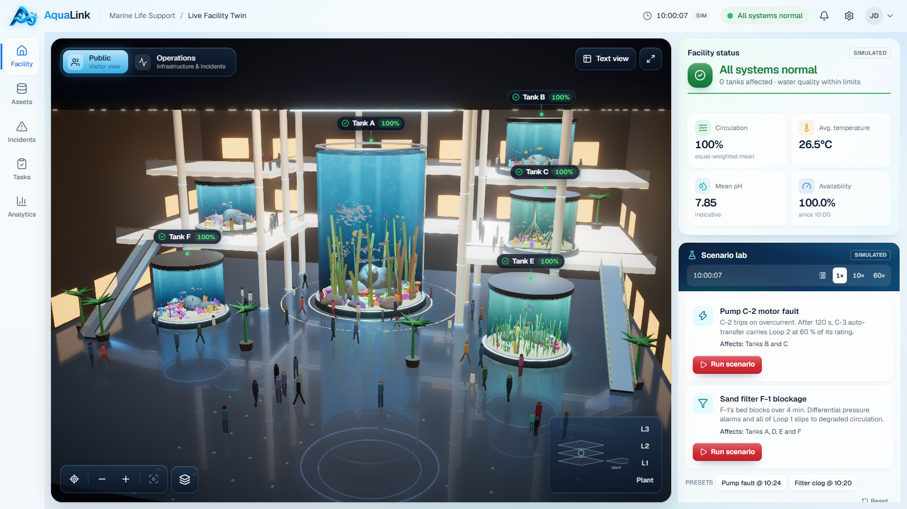
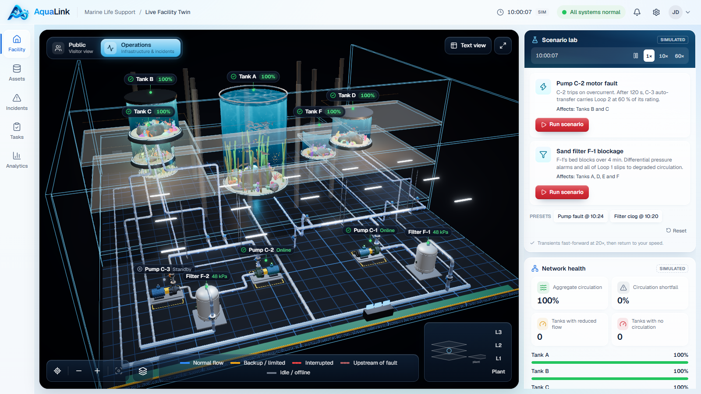
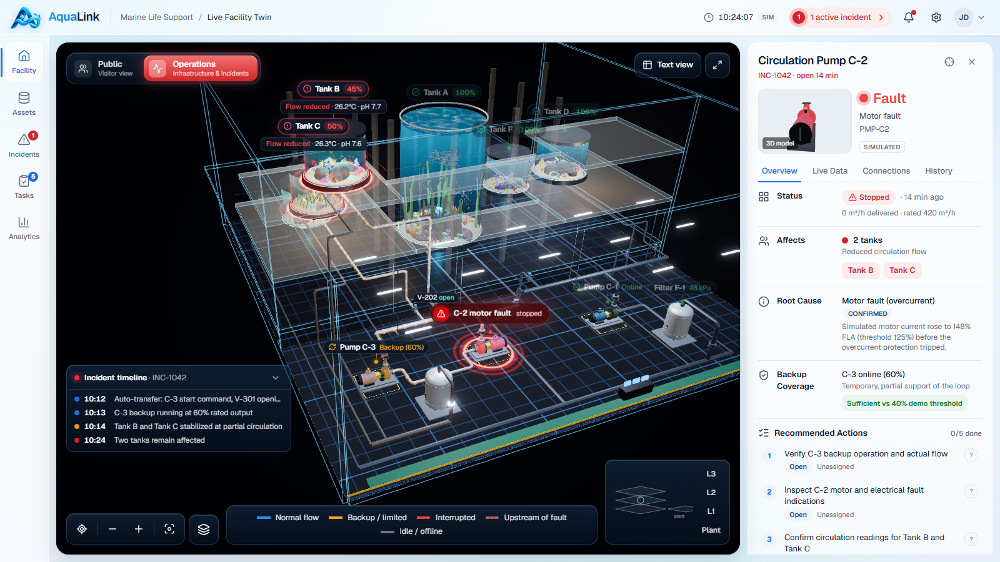
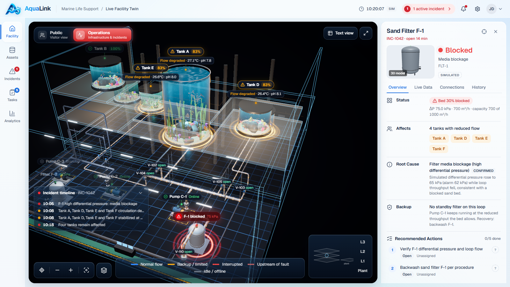
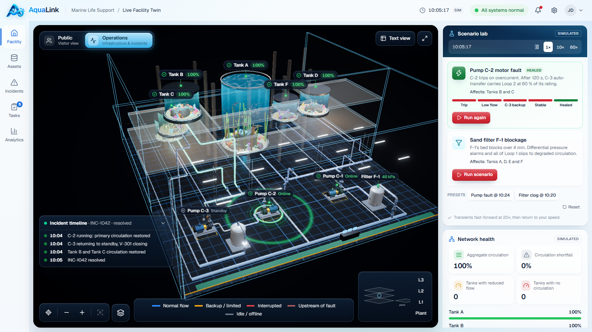
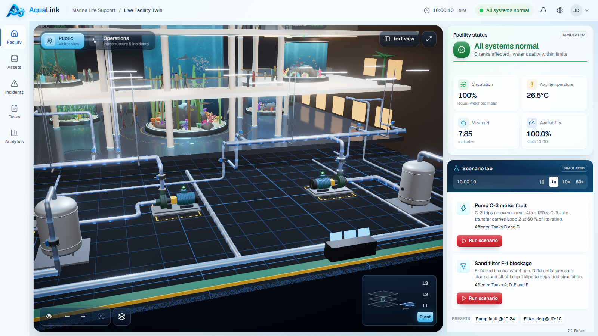
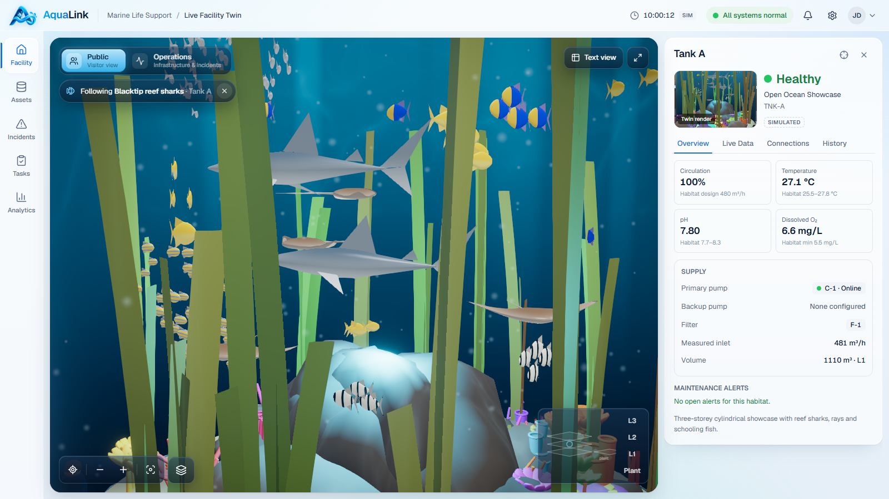

# AquaLink

**Every tank. Every connection. One clear next action.**

AquaLink is a 3D life-support digital twin for a public aquarium. One facility,
one 3D world, two ways to understand it:

| Public view | Operations view |
|---|---|
|  |  |
| The visitor-facing atrium: six habitats, marine life, visitors walking between tanks, compact tank labels, facility status, the Scenario lab and a per-tank marine-life list. | The same building as a dollhouse: the life-support plant hall behind the atrium with pumps, filters, valves and every routed pipe showing live flow. When something fails it reframes onto the fault and everything it affects. |

| Pump C-2 fault | Filter F-1 blockage | Healed |
|---|---|---|
|  |  |  |
| C-2 trips; a red wave runs down its pipes and rings mark Tanks B and C. C-3 picks up Loop 2 at 60 % of its rating. | F-1's sand bed blocks; differential pressure alarms and all four Loop 1 tanks drop to degraded circulation. | After the authorised restart or backwash, green rings sweep the root asset and the tanks it feeds. |

| Plant hall behind the atrium | Following a species |
|---|---|
|  |  |
| Orbit 180° from the visitor view (or pick *Plant*) and the back wall cuts away to show the plant hall. | Click a species under its tank and the camera flies in and follows it through the glass. |

All operational data is **simulated** and labelled as such. AquaLink does not
connect to, or operate, real equipment.

---

## Quick start

Requirements: Node.js 20+ and a WebGL2-capable desktop browser.

```bash
npm install
npm run dev
```

Open http://localhost:3000. The app opens on a healthy baseline at 10:00
simulated time.

Useful URLs:

- `http://localhost:3000/?scenario=incident&mode=operations` — the reference incident at 10:24 (C-2 fault, C-3 backup, Tank B 45 %, Tank C 50 %)
- `http://localhost:3000/?scenario=baseline&mode=public` — healthy baseline
- `http://localhost:3000/?scenario=filter&mode=operations` — sand filter F-1 blocked, at 10:20 (Tanks A, D, E and F at 83 %)
- `http://localhost:3000/?scenario=onset&mode=operations` — moments after the C-2 trip, before the backup starts
- add `&select=PMP-C2` (or any asset id) to open an asset's details

Production build (loads noticeably faster than `npm run dev`, which compiles on
first request — use it for demos):

```bash
npm run build
npm start
```

### Load time

- The 3D engine is a separate chunk; the initial page JavaScript is 271 kB.
- Every scene shader is compiled before the first frame with
  `renderer.compileAsync` (parallel compilation where the driver supports it)
  behind an underwater loading screen, so the page never freezes while the scene
  builds. A cold production load shows the 3D scene in about 3.5–4 s on the test
  machine, and about 1.7 s once the browser has cached the shaders.
- Habitat stills in the panels are pre-rendered images in `public/habitats/`,
  not rendered at runtime (that used to recompile every material for an
  on-screen pass). Regenerate them after changing a habitat with
  `node scripts/capture-habitats.mjs` while the app is running.

## Recommended 60–90 second demo

1. **Public aquarium (0–15 s).** Start at `?scenario=baseline`. Orbit the atrium (drag), zoom (wheel). Under *Habitats & marine life*, click a species (for example Blacktip reef sharks under Tank A): the camera flies into the tank and follows it. Drag to let go.
2. **Look behind the scenes (15–30 s).** Orbit 180°: the back wall cuts away and the plant hall sits behind the atrium. Press **2** for *Operations*: the whole building becomes a dollhouse with live flow in every pipe. Click Pump C-2 to trace what it feeds; everything else dims.
3. **Trigger a failure (30–45 s).** In the *Scenario lab*, choose *Run scenario* on **Pump C-2 motor fault**. The camera swings round to the fault, a red wave runs down the pipes from C-2 and rings mark Tanks B and C. The engine fast-forwards the transient: low-flow alarm, auto-transfer to C-3, stable at 45 % / 50 %.
4. **Understand the incident (45–60 s).** The panel shows C-2's root cause (*motor overcurrent — confirmed by the simulated current signal*), the two affected tanks, backup coverage and recommended actions; the compact incident timeline sits bottom-left.
5. **Take action (60–75 s).** Open *Tasks*: assign "Verify C-3 backup operation" to a technician, tick a checklist step, record a note, raise a simulated work order. Press **H** for the shift handover, generated from the current state.
6. **Heal it (75–90 s).** Back in the Scenario lab, choose *Authorized C-2 restart*: green rings sweep C-2 and the tanks as circulation returns. Then try the second scenario, **Sand filter F-1 blockage**, and heal it with *Backwash F-1*.

## What is in the app

**One shared 3D world (React Three Fiber).** Tanks A–F keep the same IDs and
coordinates in both modes. Modes change camera, visibility layers, architectural
ghosting and emphasis — never topology. The scene includes:

- multilevel atrium (L1–L3) with gallery decks, glass balustrades, cove lighting, columns, escalators, skylight and a reflective floor;
- visitors (simple body-and-legs figures) who walk from tank to tank, stop to look, and now and then lean in to take a photo with a small camera flash;
- six habitats with analytic water volume (Beer–Lambert haze from the view-ray chord through the cylinder), interior caustics and light shafts, Fresnel glass, sand, rocks, branching, brain and fan corals, flower corals, tube sponges, starfish, kelp, coloured algae, anemones, seagrass and mangrove roots; corals and plants fluoresce under the habitat light so the colour carries through the water;
- GPU-animated marine life with 28 species groups — reef sharks, cownose rays, trevally and snapper shoals, yellow and blue tangs, bannerfish, anthias, chromis, royal grammas, flame angelfish, Moorish idols, six-line wrasse, butterflyfish, moonyfish, scats, clownfish, damsels, firefish, seahorses, pipefish and mandarin dragonets. Each species has its own colours and pattern (`look` in `facility.ts`), and the counts in the panels come from the same configuration;
- the life-support plant hall behind the atrium (not below it) with modeled pumps (motor, coupling guard, volute, nozzles, status beacon), sand filters, valves with actuators and position indicators, sensors, headers, and every pipe routed in 3D under the floor and along the deck soffits; walls between the camera and the subject fade out, so orbiting never ends on a blank wall;
- flow shaders whose direction and speed follow simulated edge flow; a stopped pump never shows flow;
- fault and heal effects: a red wave travelling along the affected pipes, pulsing rings and halos on the root asset and every affected tank, and green rings and sparkles when it recovers.

**Labels** are compact HTML pills with a stem to their asset, projected every
frame at sub-pixel precision, de-cluttered by priority, and keyboard focusable.
A label only appears or disappears once that state has held for a few frames,
and it fades both ways, so nothing flickers while the camera moves. Details
expand only on hover or selection, and scrolling over a label still zooms.

**Camera.** Every programmatic move (mode switch, floor, focus, incident
reframe) is a calm glide: the target and the orbit (distance, angles) are eased
separately with a smootherstep curve, so the camera arcs round the subject
rather than cutting through it, always takes the shortest way round, and takes
longer for bigger moves. Grabbing the view stops a glide immediately.

**Look and feel.** Frosted-glass panels over a soft aqua backdrop, glossy
action buttons, and frosted-water controls over the 3D view with a lit aqua
lens marking the active choice. The public view opens on a raised
three-quarter view of the atrium with all six habitats in sight. Assets,
Incidents, Tasks, Analytics and Settings share one plain layout: a title, one
sentence on what the page is for, and the few controls it needs. The logo lives
in `src/assets/aqualink-mark.png` (tab icons in `src/app/icon.png` and
`apple-icon.png`).

**Scenarios.** Two simulated failures, run from the *Scenario lab* under
Facility status: **Pump C-2 motor fault** (Tanks B and C; healed by an authorised
restart) and **Sand filter F-1 blockage** (Tanks A, D, E and F; healed by a
backwash). Each tile shows its progress (trip or clog → alarm → backup or
degraded → stable → healed). One scenario runs at a time.

**Operations.** Facility status, network overview and flow distribution, a
tabbed asset inspector (Overview · Live Data · Connections · History), asset
registry, incidents (severity rationale, ownership, acknowledgement, notes,
timeline), Kanban tasks with checklists and notes, simulated work orders,
analytics (small-multiple trend charts with a table view) and settings.

**Single source of truth.** `src/store/useAppStore.ts` holds the published
simulation snapshot plus UI and workflow state. Every 3D object, label, panel,
KPI and report reads from it.

```
src/lib/data/        facility configuration (assets, routes, thresholds)
src/lib/topology/    dependency graph and traversal
src/lib/simulation/  hydraulics, engine, readings, KPIs, presets
src/lib/workflow/    task templates, handover and work-order documents
src/store/           Zustand store (single source of truth)
src/components/scene/       Three.js / R3F scene
src/components/viewer/      overlays: modes, scenario, layers, floors, timeline, text view
src/components/operations/  right panel, asset inspector, task cards
src/components/sections/    assets, incidents, tasks, analytics, settings
src/components/layout/      app shell, header, navigation
```

The simulation model, every assumption and the derivation of the reference
numbers are documented in **[docs/SIMULATION.md](docs/SIMULATION.md)**.

## Accessibility

- Keyboard: **1** Public, **2** Operations, **T** text view, **R** reset camera, **F** focus selection, **Esc** clear selection, **Space** pause, **H** handover, **?** shortcuts.
- Every 3D label is a focusable button with a descriptive accessible name.
- **Text view** presents all essential facility, equipment and incident information as tables; it is also the automatic fallback when WebGL is unavailable.
- Status is never colour-only: every state has text and a distinct icon.
- Reduced motion follows the OS setting or can be forced in Settings: instant camera moves, static flow indicators, near-still marine life.
- Visible focus rings, skip link, landmarks and labelled controls.

## Verification (actual results)

| Check | Command | Result |
|---|---|---|
| Simulation vs. reference scenarios | `npm run sim:check` | 39 / 39 checks pass |
| TypeScript (strict) | `npm run typecheck` | no errors |
| ESLint | `npm run lint` | no errors |
| Production build | `npm run build` | succeeds |
| Acceptance tests 1–12 in headless Chrome | `npm run test:acceptance` (app running) | 12 / 12 pass on the dev server and on the production build |

`scripts/acceptance.mjs` drives the real app with `playwright-core` and the
locally installed Chrome (`CHROME_PATH` overrides the path). It covers: shared
scene positions across both modes, healthy baseline, failure impact, cross-view
consistency (B 45 % / C 50 % in both views and panels), backup activation, the
83 % aggregate, asset inspection, real 3D orbit/zoom, the assign → step → note →
handover workflow, recovery and reset, accessibility checks, and console
errors / broken images / section navigation.

`scripts/shoot.mjs` captures screenshots the same way.

## Known limitations

- **3D assets are procedural.** Blender MCP was not available in this build
  session, so every model (architecture, habitats, marine life, pumps, valves,
  pipes, visitors) is generated in code with Three.js geometry and shaders. No
  external GLB files are used.
- **Simulated data only.** No SCADA/BMS/CMMS integration; work orders and live
  data are simulated and labelled.
- **Simplified hydraulics.** Flow sharing uses branch limits and weights, not
  pressure, friction or pump curves (see docs/SIMULATION.md §9).
- **Browser-local persistence.** Technician actions persist in `localStorage`
  for one browser; there is no multi-user backend.
- **Desktop first.** The layout targets ≥ 1280 px wide screens. Narrower
  viewers are framed by pulling the camera back; there is no phone layout.
- Rendering is tuned for desktop GPUs; quality drops automatically to
  *Balanced* when frame rate declines, and *Low* disables post-processing.

## Tech stack

Next.js 15 (App Router) · React 19 · TypeScript (strict) · Tailwind CSS 4 ·
Three.js 0.180 · React Three Fiber 9 · drei 10 · @react-three/postprocessing 3 ·
Zustand 5 · Lucide icons · Geist.
