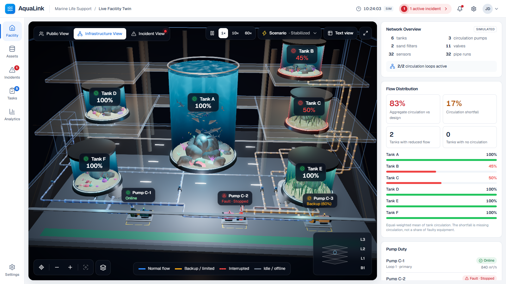
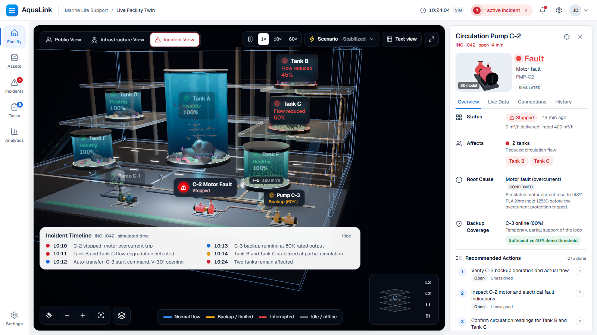

# AquaLink

**Every tank. Every connection. One clear next action.**

AquaLink is a 3D life-support digital twin for a public aquarium. One facility,
one 3D world, three ways to understand it:

| Public View | Infrastructure View | Incident View |
|---|---|---|
|  |  |  |
| The visitor-facing atrium: six habitats, marine life, visitors, compact tank labels and facility status. | The same building cut away to reveal B1 pumps, filters, valves, sensors and the routed pipe network with live flow direction. | The same geometry focused on a fault: failed pump, interrupted path, backup flow, affected tanks, root cause, timeline and next actions. |

All operational data is **simulated** and labelled as such. AquaLink does not
connect to, or operate, real equipment.

---

## Quick start

Requirements: Node.js 20+ and a WebGL2-capable desktop browser.

```bash
npm install
npm run dev
```

Open http://localhost:3000. The app opens on a healthy baseline at 10:00
simulated time.

Useful URLs:

- `http://localhost:3000/?scenario=incident&mode=incident` — the reference incident at 10:24 (C-2 fault, C-3 backup, Tank B 45 %, Tank C 50 %)
- `http://localhost:3000/?scenario=baseline&mode=public` — healthy baseline
- `http://localhost:3000/?scenario=onset&mode=infrastructure` — moments after the trip, before the backup starts
- add `&select=PMP-C2` (or any asset id) to open an asset's details

Production build:

```bash
npm run build
npm start
```

## Recommended 60–90 second demo

1. **Public aquarium (0–15 s).** Start at `?scenario=baseline`. Orbit the atrium (drag), zoom (wheel), click Tank A — the panel shows readings against habitat limits, supply pumps and a render of the habitat.
2. **Reveal infrastructure (15–30 s).** Press **2** or choose *Infrastructure View*. The building ghosts away and the B1 plant room appears under the same tanks. Click Pump C-2: its downstream dependents (Tanks B and C), and the C-3 backup path, are traced; everything else dims.
3. **Trigger the failure (30–45 s).** *Scenario → Simulate C-2 failure.* The engine fast-forwards through the transient: C-2 trips, B and C lose circulation, the low-flow alarm fires, auto-transfer starts C-3 and the loop stabilises at 45 % / 50 %.
4. **Understand the incident (45–60 s).** Press **3**. Red C-2, amber backup flow, reduced tanks, the root cause (*motor overcurrent — confirmed by the simulated current signal*), backup coverage and the grouped timeline.
5. **Take action (60–75 s).** Open *Tasks*: assign "Verify C-3 backup operation" to a technician, tick a checklist step, record a note, raise a simulated work order.
6. **Hand over (75–90 s).** Press **H** (or *Prepare handover*). The report is generated from the current state — incident, affected tanks, backup status, completed and pending tasks, assignees, notes and recent events — and can be copied or downloaded.

Finish with *Scenario → Recovery* to restore normal service, then *Healthy baseline*.

## What is in the app

**One shared 3D world (React Three Fiber).** Tanks A–F keep the same IDs and
coordinates in every mode. Modes change camera, visibility layers, architectural
ghosting and emphasis — never topology. The scene includes:

- multilevel atrium (L1–L3) with gallery decks, glass balustrades, cove lighting, columns, escalators, skylight and visitors;
- six habitats with analytic water volume (Beer–Lambert haze from the view-ray chord through the cylinder), interior caustics and light shafts, Fresnel glass, sand, rocks, corals, anemones, seagrass and mangrove roots;
- GPU-animated marine life (sharks, rays, a trevally shoal, reef fish, clownfish, seahorses) — counts come from the habitat configuration;
- the restricted B1 plant room with modeled pumps (motor, coupling guard, volute, nozzles, status beacon), sand filters, valves with actuators and position indicators, sensors, headers, and every pipe routed in 3D, including risers in the service shafts;
- flow shaders whose direction and speed follow simulated edge flow; a stopped pump never shows flow.

**Labels** are real HTML, projected every frame, occlusion-tested in the public
view, de-cluttered by priority, and keyboard focusable.

**Operations.** Facility status, network overview and flow distribution, a
tabbed asset inspector (Overview · Live Data · Connections · History), asset
registry, incidents (severity rationale, ownership, acknowledgement, notes,
timeline), Kanban tasks with checklists and notes, simulated work orders,
analytics (small-multiple trend charts with a table view) and settings.

**Single source of truth.** `src/store/useAppStore.ts` holds the published
simulation snapshot plus UI and workflow state. Every 3D object, label, panel,
KPI and report reads from it.

```
src/lib/data/        facility configuration (assets, routes, thresholds)
src/lib/topology/    dependency graph and traversal
src/lib/simulation/  hydraulics, engine, readings, KPIs, presets
src/lib/workflow/    task templates, handover and work-order documents
src/store/           Zustand store (single source of truth)
src/components/scene/       Three.js / R3F scene
src/components/viewer/      overlays: modes, scenario, layers, floors, timeline, text view
src/components/operations/  right panel, asset inspector, task cards
src/components/sections/    assets, incidents, tasks, analytics, settings
src/components/layout/      app shell, header, navigation
```

The simulation model, every assumption and the derivation of the reference
numbers are documented in **[docs/SIMULATION.md](docs/SIMULATION.md)**.

## Accessibility

- Keyboard: **1 / 2 / 3** switch modes, **T** text view, **R** reset camera, **F** focus selection, **Esc** clear selection, **Space** pause, **H** handover, **?** shortcuts.
- Every 3D label is a focusable button with a descriptive accessible name.
- **Text view** presents all essential facility, equipment and incident information as tables; it is also the automatic fallback when WebGL is unavailable.
- Status is never colour-only: every state has text and a distinct icon.
- Reduced motion follows the OS setting or can be forced in Settings: instant camera moves, static flow indicators, near-still marine life.
- Visible focus rings, skip link, landmarks and labelled controls.

## Verification (actual results)

| Check | Command | Result |
|---|---|---|
| Simulation vs. reference scenario | `npm run sim:check` | 31 / 31 checks pass |
| TypeScript (strict) | `npm run typecheck` | no errors |
| ESLint | `npm run lint` | no errors |
| Production build | `npm run build` | succeeds |
| Acceptance tests 1–12 in headless Chrome | `npm run test:acceptance` (app running) | 12 / 12 pass on the dev server and on the production build |

`scripts/acceptance.mjs` drives the real app with `playwright-core` and the
locally installed Chrome (`CHROME_PATH` overrides the path). It covers: shared
scene positions across modes, healthy baseline, failure impact, cross-view
consistency (B 45 % / C 50 % in every view and panel), backup activation, the
83 % aggregate, asset inspection, real 3D orbit/zoom, the assign → step → note →
handover workflow, recovery and reset, accessibility checks, and console
errors / broken images / section navigation.

`scripts/shoot.mjs` captures screenshots the same way.

## Known limitations

- **3D assets are procedural.** Blender MCP was not available in this build
  session, so every model (architecture, habitats, marine life, pumps, valves,
  pipes, visitors) is generated in code with Three.js geometry and shaders. No
  external GLB files are used.
- **Simulated data only.** No SCADA/BMS/CMMS integration; work orders and live
  data are simulated and labelled.
- **Simplified hydraulics.** Flow sharing uses branch limits and weights, not
  pressure, friction or pump curves (see docs/SIMULATION.md §9).
- **Browser-local persistence.** Technician actions persist in `localStorage`
  for one browser; there is no multi-user backend.
- **Desktop first.** The layout targets ≥ 1280 px wide screens. Narrower
  viewers are framed by pulling the camera back; there is no phone layout.
- Rendering is tuned for desktop GPUs; quality drops automatically to
  *Balanced* when frame rate declines, and *Low* disables post-processing.

## Tech stack

Next.js 15 (App Router) · React 19 · TypeScript (strict) · Tailwind CSS 4 ·
Three.js 0.180 · React Three Fiber 9 · drei 10 · @react-three/postprocessing 3 ·
Zustand 5 · Lucide icons · Geist.
